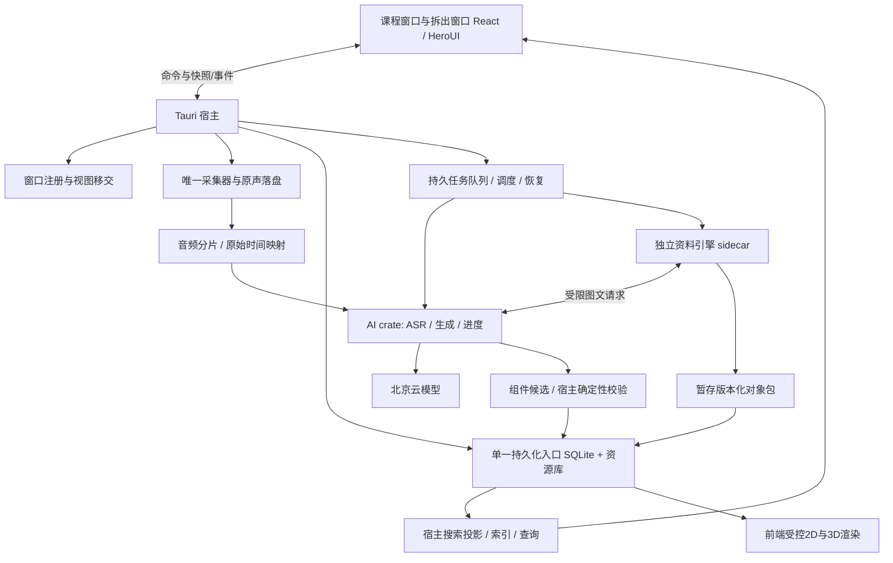

# 架构与运行边界

工程契约 2.0.0｜2026-10-18｜以下推荐均为设计，性能与平台能力尚未运行验证。

## 1. 推荐架构

采用 **Tauri 2 Rust 宿主＋React/TypeScript 多 WebView＋独立资料转换 sidecar**。AI 流程首选为宿主加载的独立 Rust crate，由宿主任务管理器调度；不再为 AI 引入第二个常驻数据库或 Node/Python 服务。资料引擎首选单独的 Python 可执行包，通过版本化 JSON Lines 协议通信，其第三方解析器子进程由引擎统一管理。前端不持有录音、模型连接、任务或数据库写权限。

图中的引擎↔AI连接经宿主能力代理转发；引擎不获得密钥，不直接读取任意资料或云账户配置。宿主把文件句柄/受限只读路径交给引擎，只允许向任务暂存目录写入。前端只能通过资源 ID 请求宿主读取授权资源。

云调用由宿主内部CredentialResolver按精确model_id与北京地域绑定专用凭据槽位；四个模型不可共用通用fallback key，重试/恢复也不能串用。唯一映射表见INTERFACES §9.1。AI流程拥有服务协议逻辑，宿主拥有实际凭据解析边界，资料引擎只请求受限图文能力。

| 组件 | 职责与状态所有权 | 明确排除 |
| --- | --- | --- |
| React UI | 开始页、课程桌面、六格布局、编辑器、来源对照、草稿与选区、组件渲染/交互/无障碍、搜索UI/定位、focaus呈现；显示宿主确认状态 | 直接 SQL/音频采集/模型请求/自行生成来源 ID |
| Tauri 宿主 | 录音仲裁、文件持久化、数据库、命令校验、窗口与菜单栏、任务状态、提交事务、组件确定性计算、搜索提取/索引/查询 | 用 UI 是否存在判断任务是否存活 |
| AI crate | 协议适配、ASR 上下文、派生内容提案、事实/术语/进度/问答、focaus衔接、组件发现/参数候选/语义检查；业务编排和云 I/O | 直接修改 note/raw 表，擅自提交迟到结果 |
| 资料引擎 | PDF/PPTX 解析、页资源、布局与对象重构、局部重试、纠正重放、课件搜索文本/原位锚点；产出候选版本包 | 修改笔记、建立另一个权威课程库、复制用户凭据 |
| 本地存储 | 一个应用库保存权威元数据、版本、引用、任务与事务；资源库保存不可变字节 | 以浏览器 localStorage/引擎缓存/服务 task_id 作为事实库 |

首版本机资料库，无产品账号；登录只是占位。不增加同步服务器、协同编辑云端、跨课程问答、联网搜索或系统声功能。离线验收只承诺录音，其他内容可以显示已有缓存，但不扩展为离线产品承诺。

## 2. 可逆实现选择与取舍

- 宿主数据库首选 SQLite，WAL 和单写者队列；短事务负责元数据/版本/引用/任务的原子提交。大文件不塞进数据库。持久层通过 repository 接口注入 AI/引擎适配器，总控拥有迁移文件，后端实现执行器。任何耗时网络、转换、渲染不得放在写事务内。
- 音频首选 Rust 原生采集绑定（优先评估 CPAL/CoreAudio 路径），使用独立实时回调与落盘线程。是否需直接 CoreAudio、具体格式与缓冲大小由 U01/U02 实测；不能改用 WebView MediaRecorder 作为权威采集器。
- 结构化笔记首选 ProseMirror 文本事务层＋独立标准对象模型＋自定义公式/表格/图形节点视图。编辑器 JSON 不是持久化唯一格式；将编辑事务转换为 DATA 的细粒度 patch。图表和结构图用可编辑数据模型渲染，不能嵌入截图代替。库选型实验必须覆盖 U06，若不满足换适配层，不改公共对象身份。
- 普通 UI 遵守 HeroUI React v3 默认主题与 React 19+/Tailwind CSS v4 基线，默认随系统深浅色。实施 UI 时使用 heroui-react 技能核对当前安装/API，不套用 v2 Provider，不在此固定像素、品牌色或动画曲线。
- PDF 首选 PDFium 系渲染/文字几何提取与 pypdf 结构读取；PPTX 首选 python-pptx/OOXML 保留原生语义，LibreOffice 独立进程生成页预览作首选评估路线。扫描页/图表以 qwen3.8-flash 图文理解辅助，必要本地 OCR 后续按样本选择。依赖兼容、许可与 Apple Silicon 打包均属 U07，未安装验证。底层库不保证语义恢复；对象关联、置信度与编辑能力由引擎自己承担。
- 引擎隔离使崩溃、CPU 峰值、第三方解析失败不会直接杀死采集线程；代价是协议/打包/资源传输复杂。AI 首选宿主内模块减少额外运行时；必须使用异步网络和受限工作池，禁止在音频线程运行推理解析。若实测出现进程级不稳定，由总控将 AI worker 外置，保持同一任务契约。

## 3. 录音的可靠路径

唯一采集器由应用进程级 RecordingCoordinator 持有，包含 `recording_id`、状态、归属 epoch、录音档位和设备状态。所有课程窗、拆出窗、菜单栏控制同一会话；并发 start 在宿主仲裁，不能创建两条主动麦克风流。未选课程/课堂允许先开始，归属字段为空。

采集回调只写有界环形缓冲，专用 writer 先保存未经降噪的原声片段与时间日志，完成片段校验和与持久化水位。ASR 独立支路消费已定位的帧/片段，不反向阻塞 writer；低延迟可读取尚在队列中的帧，但只有原声持久化可确认其可恢复性。断网、ASR失败、生成失败和引擎崩溃均不取消录音。

推荐原生采集保存分段未压缩 PCM 容器（首评 CAF），以较短可恢复段限制损坏范围；分段/flush/fsync周期是工程参数，U01 决定，不能宣称尚未落盘的内存可恢复。写入流程：暂存字节→校验/同步→原子完成文件→事务登记 AudioAsset/AudioSpan→推进 durable watermark。崩溃后扫描本会话清单与已完成/未完成段，恢复可解码前缀并记缺口，不把空白补成录到的声音。

磁盘慢或写满时不能无限缓存：保留已落盘片段、尽力封口、发布显著 capture_error，并记录实际丢失区间。采集暂停/设备中断/睡眠与普通静音分别记状态；没有证据时缺口边界标不确定。重启恢复数据和任务，绝不自动打开麦克风。

本地预处理分支首先做格式/采样率/通道适配，再实验电平/降噪/去混响。所有派生音频必须带逐段时间映射；滤波补偿和裁剪不可隐藏。异常立即旁路到基础适配。原声不覆盖，听感提高不等于 ASR 提高。

## 4. 任务调度、背压与实时优先

任务统一由宿主管理。以下为优先级政策，不预先承诺云服务并发/吞吐数值：

| 资源级别 | 工作 | 背压与饥饿处理 |
| --- | --- | --- |
| R0 独立采集资源 | 麦克风回调、原声 writer、停止封口、故障日志 | 独立线程/磁盘预算；任何低级工作不得占用该队列 |
| R1 实时交互 | 当前 streaming、用户 focaus、录音控制、当前进度 | 预留网络/执行容量；focaus 有独立 deadline，不等待历史补齐 |
| R2 当前课堂整理 | 二次转写、增量笔记、用户问答、显式局部纠正、当前窗搜索查询/组件参数计算 | 同目标合并最新未运行输入；保护交互响应与稳定内容 |
| R3 恢复与收尾 | 历史 filetrans、停止后尾部整理、用户指定重整 | 记录 durable cursor，分片公平轮转；显式用户任务可提升但不能压 R0/R1 |
| R4 可延迟处理 | 深转换、历史语言档生成、非当前资料重解析、可视化发现/生成/校验、搜索批量重建 | 页级检查点，可暂停/降并发；积压可见，不吞掉失败 |

网络限流按提供方/模型各自预算，CPU、磁盘、内存、上传另有限额。引擎读大文件与上传需低优先级限速，其material_understand子任务继承转换优先级，不能因改走AI接口抢占R1。录音磁盘水位不足先停转换/缓存写入。没有性能证据前以保守并发启动，保留可观测队列等待、运行、取消和延迟分解。历史任务老化获得空闲时隙，不能靠永不执行满足实时表面指标。

断网：录音持续，保存未覆盖 AudioSpan；恢复后立即以最新音频建立 streaming，新连接是新 remote task。历史跨度交给 filetrans，按原始时间填洞。稳定实时句段获最高合并优先级，重叠是定位上下文，不是覆盖授权。模糊边界保候选/待校对，不靠仅文本相等去重。

进度采用每课堂 single-flight＋latest-wins：约每10秒取最新可得转写与带页课件文字；没有新增证据也更新陈旧显示，无需重复付费调用。允许同一任务的网络超时，但新调度只保留最新待运行快照，不排队处理过期位置。以证据音频截止计算陈旧，录音中落后超过30秒标待更新。

笔记按完整知识段和明确作业/DDL/考点触发；每两分钟兜底检查有无新内容，不是无条件全量生成。二次转写按稳定句批次滚动。停止后收尾先等已录区间的可得转写，缺口/失败显式保留；后补转写再发更新提案，不宣称一次 stop 就全部完成。

## 5. 快照、事务与恢复

每项云请求绑定 InputSnapshot：来源精确版本与 hash、可见音频截止、资料范围、录音归属 epoch、事实/编辑 revision、语言档、契约和提示模板版本。模型输出是候选，不直接成为权威内容。

宿主提交时检验快照与当前目标：

1. 原始 ASR 结果按 AudioSpan 与远端连接映射提交；即便归属已改，音频事实仍随 recording_id 归新课堂，旧上下文只能标 provenance，不能改已定稿句。
2. 笔记、二次转写、术语、安排、问答与进度若目标归属/来源/编辑状态变化，执行相应冲突政策；来源过期可保候选供预览，不能覆盖新状态。
3. 结果内容、引用边、任务终态、事件 outbox 在一个事务内提交。资源先暂存，事务成功后对外可见；失败孤儿可清理，不能先发布未持久化事件。

来源持续追加不必让所有在途工作失效：宿主比较被引用selector的内容及实际touched范围，新尾句/不相交的用户编辑可保旧快照并安全重放局部提案；被引用内容改变、删除、归属epoch变化或保护范围相交才按对应政策拒绝/转预览。UI仍标此结果的真实证据截止及后续待整理范围，不能把旧范围标为已追到现在。

启动恢复将 `running` 任务标 `interrupted` 后分类：远端已提交 filetrans 查询原 task；可重放的本地转换从页检查点续做；生成按同一幂等键与快照决定复用或新 attempt；不复活过期进度。录音会话改 interrupted/recoverable，不主动采集。凭据与可访问上传 URL 不进入日志、事件、备份或错误正文。

## 6. 窗口与任务不是同一生命周期

一个应用宿主管理多课程原生窗口，各窗维护选中课堂；每个内容 view_id 永久绑定创建时的课堂/内容目标，除明确重绑事务外不随左栏选择变更。全局录音仍只有一个；顶部/菜单栏显示实际归属。

网格的拆出/放回是视图移交，使用宿主 `view.move` 两阶段协议：持久草稿/选区/滚动→新承载准备→确认后释放旧承载。移交期间只有一个 edit lease，不能出现两份独立笔记。关闭/缩小/最大化不取消任务；最后一窗关闭保留菜单栏后台。明确退出先停止并保存采集，再 checkpoint/cancel 本地任务；远端任务无法保证取消时记录状态供重启查询。

## 7. 公开依据与能力边界

2026-10-17文档阶段直接读取 [Tauri 进程模型](https://v2.tauri.app/concept/process-model/)：core 管理全局状态、窗口和 IPC；这支持职责划分，不证明录音跨关窗可靠。其他已核对公开入口见 [技术路线](../../.project-continuity/docs/TECHNICAL-ROUTE.md)：[托盘](https://v2.tauri.app/learn/system-tray/)、[sidecar](https://v2.tauri.app/develop/sidecar/)、[窗口 API](https://v2.tauri.app/reference/javascript/api/namespacewebviewwindow/)。本轮未重跑这些 API。

北京模型协议见 INTERFACES §9。服务支持时间戳/图文/结构化返回不等于产品能满足低延迟、正确引用或原生编辑。所有 U 项按 VALIDATION 验证，不能用接口文档或架构图关闭。

## 8. C07：原生交互组件的生成、计算与运行

**推荐注册表/模板＋结构化参数。** C维护模板ID、协议、参数约束、允许资源/操作、公式与验证样例规范；A产出有课堂证据的候选；N实现无网络的确定性计算/校验与持久化事务；F实现同一注册表键的编辑器节点、渲染、交互和无障碍替代；E提供页/区域/公式/变量/数据及来源，不另建教学算法或插入笔记。原生对象 `interactive_visualization` 与表格/图表共享移动、组合、复制和来源能力，记录独立运行子协议。

完整链路：

1. 宿主在笔记已提交的Fact增量/用户明确重整后，合并待发现范围，提交低优先级 `visualization_discover`。A判断是否有参数影响、变量关系、空间/运动/算法步骤或难以用文字说明的机制；简单事实/重复装饰返回no-op，不按段落数量硬生成。
2. A选择最小足够表达：变量曲线优先2D，空间/滑动对应需要时用3D；产出目的、对应Fact/定义/变量作用域、课堂参数、推导值、示例值与来源。缺少关键定义时给 `needs_evidence`，不猜课堂采用哪种卷积。
3. 宿主按DATA §11的语义键匹配已有对象/删除意图。相同知识与目的复用身份；来源新版本仅生成更新提案；手改参数受保护。A仅返回候选key，不能新造权威UUID。
4. `visualization_build`将候选约束到受支持模板、绑定精确InputSnapshot，生成结构化描述。无支持模板给unsupported理由，不能偷偷插入外链或可执行脚本。
5. `visualization_validate`由N核对schema/引用/资源/维度/参数/确定性计算；A的语义检查核对课堂定义/讲授角色，两者都通过才可自动插入未受保护的笔记位置。公式验证失败留诊断/可重试状态，不插“看似合理”的动画；输入区相交转review/defer。发布通过result.submit/proposal.apply，与引用和undo同事务。
6. F按对象协议渲染。参数编辑先显示草稿，调用 `visualization.evaluate` 得到带参数hash的确定性结果；仅最新参数结果可呈现。持久化经 `visualization.patch` 再验证，返回新revision；渲染器不自行写权威数值或来源。播放逐步展示已验证的计算路径，不每帧请求模型/数据库。

| 表达方式 | 适用边界与取舍 |
| --- | --- |
| 结构化描述 | 公式、数据、步骤、节点关系可审计/迁移/搜索；描述使用封闭表达式AST与算子，不允许eval/任意URL/函数体 |
| 受控模板 | 首版首选；参数驱动、确定性校验、跨档共享、离线读取已存组件。模板能力需要自行实现与验收，库不提供课堂正确性 |
| 模型生成代码 | 首版不作为自动插入通道。若模板确实无法覆盖，先由C做独立能力变更和实验；不得把源码藏进extensions直接执行 |

未来若引入生成代码，必须使用无Tauri能力的隔离执行环境，禁任意文件/网络/凭据、宿主IPC和动态依赖；只能接收只读结构化输入，通过白名单消息传受限输出。限制CPU/内存/时长/资源类型，可终止重建，错误回到原生说明。普通iframe或同WebView Worker不自动等同安全隔离，必须实证隔离边界后才能开放，当前包不接受任意code字段。

组件任务属于R4，随笔记变更合并，页/对象级checkpoint；focaus不等待它生成。可见组件短参数计算与搜索用R2受限CPU池，批量矩阵计算可中断分片，超预算拒绝而非占采集线程。GPU由F的每WebView渲染管理器持有，N只协调全局资源租约与可见性，不跨WebView共享WebGL句柄。只对可见且交互中的组件按需绘制，最小化/离屏/无可见承载时停止动画、释放可重建GPU资源；多窗口总预算由U12测定，不能按每组件各无限开Canvas。

context lost时停止播放、保结构数据和最后已提交参数，显示文字/表格/静态预览；恢复后重建资源并保持暂停。拆出事务先提交必要参数/视角，目标窗ready后旧窗释放GPU，移交期间不能双播放。应用重启恢复步骤与视角但不自动播放。减少动效默认禁自动演示；所有调参、单步、旋转/重置均有键盘入口，提供可读局部计算/等价数据表，不用“看动画”作为唯一信息通道。失败降级是可读性保障，不算3D交互验收通过。

### 8.1 官方候选核对与选库出口

2026-10-18通过公开官方README、LICENSE、仓库元数据/最新release和默认分支commit核对，无安装/运行。日期按源记录；“未归档＋近期提交”只是维护迹象，不是质量/兼容性保证。

| 候选与官方证据 | 能力/许可证/维护观察 | 本项目推荐评估及限制 |
| --- | --- | --- |
| [Three.js](https://github.com/mrdoob/three.js)、[LICENSE](https://github.com/mrdoob/three.js/blob/dev/LICENSE)、[r186](https://github.com/mrdoob/three.js/releases/tag/r186) | 通用3D，WebGL/WebGPU渲染；MIT。r186发布2026-09-24，默认分支2026-10-17有提交，未归档 | 首评WebGL2路线；当前WebGLRenderer自r163不支持WebGL1。不是卷积算法库，也未证明本机WKWebView支持全部特性 |
| [React Three Fiber](https://github.com/pmndrs/react-three-fiber)、[LICENSE](https://github.com/pmndrs/react-three-fiber/blob/master/LICENSE)、[v9.8.2](https://github.com/pmndrs/react-three-fiber/releases/tag/v9.8.2) | Three.js的React renderer；MIT。v9.8.2发布2026-10-15，默认分支2026-10-14提交，未归档；README明确v9配React19、v8配React18 | 推荐先评R3F v9＋Three.js的React19组合；精确版本、peer依赖、打包和性能待U12。声明兼容不等于Tauri通过 |
| [D3](https://github.com/d3/d3)、[LICENSE](https://github.com/d3/d3/blob/main/LICENSE)、[v7.9.0](https://github.com/d3/d3/releases/tag/v7.9.0) | Web标准数据驱动SVG/Canvas/HTML；ISC。v7.9.0发布2024-03-12，默认分支2026-05-28文档提交，未归档；未据此声称活跃发布或已停维护 | 2D优先React拥有DOM、D3用于比例尺/布局/数学数据转换；复杂绘图用受控Canvas。避免React与D3同时修改同一节点 |

[Tauri官方WebView说明](https://v2.tauri.app/reference/webview-versions/)确认macOS使用系统WKWebView；不是内置Chromium，须测目标macOS/WebKit、WebGL2初始化、context恢复、多个课程/拆出窗总开销。[R3F按需渲染说明](https://r3f.docs.pmnd.rs/advanced/scaling-performance)提供frameloop=demand和invalidate思路；具体可见性、资源dispose、键盘与恢复由本产品实现。本轮参考本机visualize技能的适用触发与交互思想；不复制Codex宿主协议、window.openai、用户主目录路径、资源或样式，不把该技能作为产品依赖。最终选库在U11/U12样例通过后由C锁定，保MIT/ISC声明和依赖许可清单。

## 9. C08：宿主全文搜索投影

搜索采用本地、确定性全文查找，不调用AI/语义检索。E输出课件所有已处理页的文字与原页/对象对应锚点；N从权威笔记图和两层转写提取SearchUnit，并接收E提取结果，在同一SQLite内维护**可重建的搜索投影**，不会创建第二个内容权威库。F只提供当前聚焦view及实际显示档/版本，渲染命中/高亮/跳转。

首选按NFC＋Unicode casefold规范化后做文字子串匹配，包含中文单字/短词和中英混合；每个投影保存规范化位置到原文稳定锚点的映射。SQLite派生表记录索引版本和覆盖，受限后台池按scope查询所有文本单元；首版不强依赖FTS分词才能召回短中文。后续若U13表明需要FTS/trigram候选加速，必须保同一精确复核与短词回退，不能丢召回或改变匹配语义。

内容提交事务登记dirty范围并使旧head搜索结果失效，增量更新优先于R4全量重建；同步小增量时也不延长录音写事务。查询绑定当前scope/head快照与index_generation，索引落后显示partial/indexing。删除/移除/归属转移的可见性屏障与权威变更同事务，查询、分页、定位和UI事件均重新核查；不能等异步清索引后才隐藏。历史快照必须显式选择，永久删除对历史同样生效。结果针对完整文档，虚拟列表/未挂载页只影响渲染，高亮时再挂载。

## 10. C09：focaus的自适应取舍与理解衔接

focaus回答“接下来怎样听懂”，笔记保存详细知识结构，普通摘要压缩历史内容，ProgressState只提供带证据时间的位置。四者不共用一份每10秒重写的正文。保留内部catchup命令/任务名，用户可见名称一律focaus。

用户触发后，N在15秒总预算内建立范围和快照，读取此刻可得全局进度；A以最新可得原始/二次转写为主，结合本堂有效材料、Fact/Definition索引检索前提，不等待下一轮progress、二次层补齐或可视化。检索更早定义遵循本课堂当前作用域→本课堂先前→同课程先前适用定义，带明确来源/时间；跨课程不自动输入。N执行本地结构检索，A决定必要取舍，E只提供材料依据；该有界内部检索不同于Command+F范围，不能借其开放全课程搜索UI。

生成前按当前教学活动组织单一理解路径：长漏听先主题关系与接回关键链；连续推导补符号/条件/中间结果；例子说明应用的概念和正在观察什么；主题转换连接上一结论/局限与新问题。回看窗口仍为max(估计漏听,5分钟)，可由用户改/定起点；更早前置以outside_window标识并说明用途，不暗中扩大“老师在回看内讲了什么”。不根据用户失焦推断掌握程度，默认简短，深入阅读交给笔记。

A输出当前问题/步骤、漏听关键、衔接关系及必要前置，允许合成连贯段落，不固定四块或平均压缩每分钟。有课堂证据才称“老师如何推进”；缺证据时标系统补充解释或unknown，不能编造教师动机/先后因果。宿主校验C09来源/定义/角色/覆盖及完整性后提交；需要但缺失的衔接保partial，不以流式首段宣称完整。性能必须包含检索、生成、校验与显示，必要时实验预建有来源的语义索引减少开销，不能为15秒删除必要前提。

正文固定其body_evidence_cutoff和progress_at_trigger；动态指针单独读最新ProgressState，二者各显证据时间与缺口。新指针不能把旧正文改标当前，亦不能把正文润色当新进度。新触发新结果，迟到旧结果不覆盖当前卡片；记录请求代次和录音归属epoch。具体契约见DATA §13/INTERFACES §13，真实理解效果见V25/V26。
